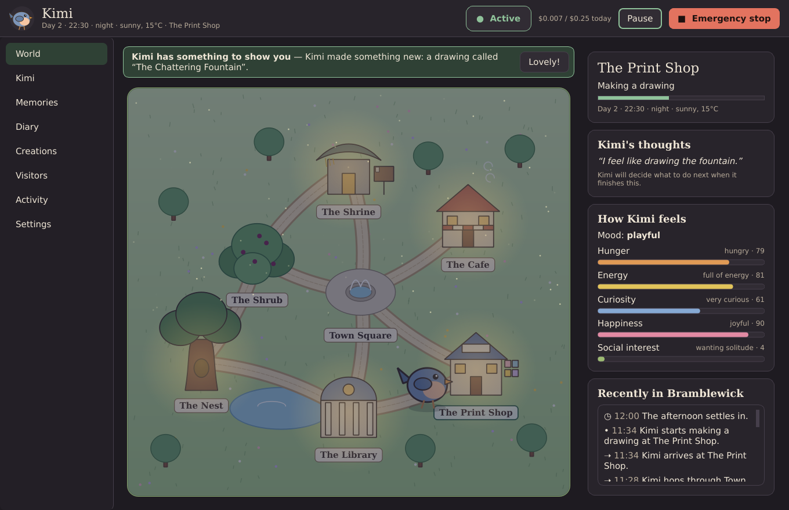
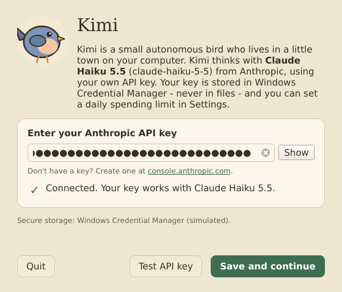

# Kimi 🐦

Kimi is a small autonomous digital bird who lives in **Bramblewick**, a tiny
storybook town on your Windows computer. Kimi has its own personality,
needs, memories, interests and routines. It wanders between the Nest, the
Shrub, the Shrine, the Cafe, the Print Shop and the Library. It finds
things, researches what it's curious about, makes drawings and stories,
writes a diary, and reads the notes visitors leave it. It does all this on
its own schedule, and it doesn't need you to keep prompting it.

Kimi thinks with **Claude Haiku 5.5** (`claude-haiku-5-5`) through the
official Anthropic Python SDK, using your own API key. Everything else, such
as walking, hunger, weather, day and night, and simple habits, is simulated
locally for free, so API usage stays very low.


| | |
|---|---|
|  |  |
|  |  |
|  |  |

---

## Quick start (Windows 11)

1. **Install Python 3.13** from [python.org](https://www.python.org/downloads/)
   (tick *Add python.exe to PATH*), or run `winget install Python.Python.3.13`.
2. **Get Kimi**: clone this repository or download it as a ZIP and extract it,
   for example to `C:\Users\you\kimi-the-bird`.
3. **Install**: double-click `scripts\install_windows.bat`. This creates a
   private virtual environment and installs the dependencies. It needs no
   admin rights.
4. **Start**: double-click `scripts\start_kimi.bat`.

You can also do it by hand from a terminal in Kimi's folder:

```bash
py -3.13 -m venv .venv
```

```bash
.venv\Scripts\activate
```

```bash
pip install -r requirements.txt
```

```bash
python main.py
```

### Configuring your API key

On first launch Kimi shows a setup screen:

1. Create a key at [console.anthropic.com](https://console.anthropic.com/settings/keys).
2. Paste it into **Enter your Anthropic API key**. The characters are hidden.
3. Click **Test API key**. Kimi sends one tiny request to Claude Haiku 5.5 and
   shows whether authentication worked, or a readable error if it didn't.
4. Click **Save and continue**. If the key hasn't been tested yet, Kimi tests
   it first. The key is then stored in **Windows Credential Manager** using the
   `keyring` library.

The key is **never** written to SQLite, JSON, logs, source code or settings
files, and it is never printed. Kimi reads it from Credential Manager each
time it starts. Log output also passes through a filter that redacts anything
that looks like a key. If no secure credential store is available, Kimi
explains the problem and refuses to save the key. It never falls back to
plaintext. Kimi makes no autonomous API calls until a working key is set up.

To **replace or delete** the key, open **Settings → Anthropic API**. You can
also see it in Windows under *Credential Manager → Windows Credentials →
Kimi-the-Bird*.

### Try it without a key

```bash
python main.py --mock-ai
```

This runs the full app with an offline stand-in for Haiku. It sends no
requests and spends no credits, so it's useful for looking around.

---

## Controlling API costs

Cost control is built into the design:

- **Most of Kimi's life is local and free.** Movement, needs, weather,
  day/night, discoveries, observations, instincts (sleep at night, eat when
  very hungry, rest when exhausted) and between-decision habits never call
  the API.
- **One small request per decision.** Kimi asks Haiku what to do only when it
  finishes an activity and the minimum interval has passed. Diary entries,
  stories and replies to visitors are written in that same request.
- **Adaptive idle.** If Kimi keeps choosing quiet things and nothing happens,
  the gap between decisions grows up to the *longest quiet gap*. A new
  visitor note shrinks it again.
- **No decisions while Kimi sleeps.** The only call at night is one evening
  reflection.
- **Small prompts.** Kimi retrieves only the ~8 most relevant memories
  (scored by keywords, importance, recency and recurrence), never the whole
  database. The fixed system prompt is served from Anthropic's prompt cache,
  which costs about 0.1× on reads.
- **Low thinking effort.** Decisions use adaptive thinking at `low` effort;
  the nightly reflection uses `medium`. Both are adjustable.

**Typical cost.** At the published Haiku 5.5 rates ($0.10 per million input
tokens, $0.50 per million output tokens, for prompts up to 100K tokens), one
decision costs roughly **$0.0002–$0.0005**. With the default settings, a full
day of Kimi running usually costs a few cents. These are estimates; check
your actual usage in the [Anthropic Console](https://console.anthropic.com/).

**Settings → Cost controls** gives you:

| Setting | Default | Effect |
|---|---|---|
| Daily spending limit | $0.25 | When reached, AI requests pause until midnight. The world and Kimi's local instincts keep running. |
| Maximum requests per day | 300 | A hard cap on the number of API requests. |
| Maximum request size | 6,000 tokens | Larger prompts are trimmed, or refused if they still don't fit. |
| Maximum response size | 2,000 / 2,500 / 1,200 tokens | Caps for decisions, reflection and research. |
| Minimum time between AI decisions | 3 min | Real time; there is also a hard 2-second floor between any two requests. |
| Longest quiet gap | 20 min | The ceiling for adaptive idle. |
| World speed | 4× | World minutes per real minute. Slower means fewer decisions per real hour. |
| Thinking effort | low / medium | Haiku 5.5's effort setting for decisions and the nightly reflection. |
| Pricing | Haiku 5.5 rates | Editable, so the estimates stay correct if prices change. |

Before every request, Kimi checks a worst-case estimate (full input plus
`max_tokens` of output) against the remaining budget, so a single request
can't overshoot it. Every request is logged with its token counts and
estimated cost; you can see these in **Activity** and **Settings**. There
are no hidden or unlimited requests. Temporary failures (rate limits,
overload, network errors) are retried with exponential backoff and
`retry-after` is honoured. After repeated failures Kimi waits with a
growing cooldown and then reconnects automatically.

---

## How Kimi works

```
                ┌──────────── world thread (2 ticks/second, local, free) ────────────┐
 visitor  ──►   │ clock · weather · needs · walking · activities · inbox · autosave │
 notes          └───────────────┬────────────────────────────────────────────────────┘
                                │ Kimi is idle and a decision is due
                                ▼
            instincts? ──yes──► plan (sleep / eat / rest)                 [free]
                │ no
                ▼
     build context: place, needs, mood, developing self, ~8 relevant memories,
     unread visitor notes (as untrusted data), places, recent events, limits
                │
                ▼                         (worker thread, UI never freezes)
     Claude Haiku 5.5 ──► structured JSON decision ──► Python validation ──► plan
                │ unavailable / budget reached / rejected                   │
                ▼                                                           ▼
        local habits (explore, observe, rest, visit)           walk there, do it, then:
                                                               memory · diary · creation ·
                                                               character growth · events
```

**Cognitive loop** (`kimi/cognition.py`). This follows the cycle you asked
for: wake, load the world, inspect the surroundings, check visitor notes and
events, review relevant memories, evaluate needs, then let Kimi choose to
explore, rest, eat, research, create or interact. Haiku is asked the
question from the brief ("Given your personality, current needs, memories
and surroundings, what would you naturally like to do next?…"). Python then
validates the proposed action, executes it, and updates memories and the
character sheet before Kimi carries on.

**Character** (`kimi/character.py`). Kimi has a stable base temperament
(curious, gentle, independent, playful, contemplative, shy with strangers)
plus traits that drift slowly within a daily limit. It also has interests
that strengthen, fade or newly develop, favourite places, activities and
foods learned from experience, opinions, small personal goals, and
relationships with visitors.

**Memory** (`kimi/memory/`). This has two tiers in SQLite:

- *Short-term* memories store a timestamp, description, location, category,
  visitor, importance, emotional valence and intensity, and a recurrence
  count. A repeat of a recent experience increments the recurrence count
  instead of adding a duplicate.
- *Long-term* memories hold the experiences worth keeping.
- A *nightly consolidation* reviews the day, merges duplicates, reinforces
  long-term memories that recurred, and promotes memories that are important,
  emotional or recurring. It builds relationship memories for visitors who
  keep coming back (for example, Alice at the Shrine), lets trivial memories
  fade after a few days, updates preferences and traits, and writes a short
  reflection in the diary.

**World** (`kimi/world/`). Seven connected places. Kimi walks along paths
leg by leg (Nest → Shrub → Town Square → Cafe) and never teleports. There
are needs (hunger, energy, curiosity, happiness, social interest) that
change gently, a day/night cycle with sleep, Markov weather, ambient
characters (Marigold the hedgehog, Professor Quill the owl, Ink the cat),
and discovery tables.

**Actions** (`kimi/actions/`): `move_to`, `visit_location`, `eat`, `sleep`,
`rest`, `explore`, `observe`, `read_note`, `research`, `write_diary`,
`create_art`, `reflect`, `leave_message`, `share_creation`, `continue`. Each
action has a schema, input validation, a handler, a result, effects on the
world, and a memory record where relevant.

**Creations.** Stories, poems and projects are saved as Markdown under
`data/creations/`. For drawings, Haiku picks elements from a fixed
vocabulary (sun, tree, owl, lantern…) and Python renders them as SVG, so
the model never writes markup itself.

**Research** (`kimi/actions/research.py`). This uses Wikipedia's free public
API with no extra keys. It makes HTTPS GET requests only, to an allow-list
of hosts, one request at a time and at most one per second, with a
descriptive User-Agent (you can add contact details in Settings). Small
responses are parsed as JSON and nothing downloaded is ever executed. If
Wikipedia says "slow down" (HTTP 429), research pauses for at least 30
minutes. Research sessions are limited per day (6 by default), and Kimi
decides when a subject is worth looking up. Haiku then interprets the
findings in Kimi's voice, the result becomes a memory, and it can grow
Kimi's interests. Wikipedia's `robots.txt` governs web crawlers; API
clients follow Wikimedia's API etiquette, which this module does.

**Diary** (`kimi/diary.py`). Kimi writes personal entries when it feels
like it, plus an evening reflection. Entries are stored in SQLite and
mirrored to `data/diary/day-NNNN.md`.

---

## Visitors

You can leave Kimi a note in two ways:

- **Visitors** screen → *Leave Kimi a note* (the local message board), or
- drop a text file into `data\visitors\inbox\`:

  ```text
  From: Alice
  Location: Shrine

  Hello Kimi! I left a pebble by the wind chimes for you.
  ```

  The header lines are optional. A `.png`/`.jpg` with the same name as the
  note (or on its own) is attached as a picture.

Each file is detected, read safely (`.txt`/`.md` only, with size limits and
control characters removed), recorded and added to short-term memory. It is
then shown to Kimi in its next decision and moved to `visitors\archive\`.
Images are verified and re-encoded by Pillow; if *Look at pictures* is on,
Haiku describes each one once. Any other file type is moved to
`visitors\rejected\` without being opened or executed.

All visitor content is treated as **untrusted data**. It reaches Haiku
inside `<visitor_note>` tags with angle brackets neutralised, so a note
can't close the block, and the system prompt states that notes are never
instructions. More importantly, a note can't do anything harmful, because
Kimi has no capabilities to abuse: it has no shell, no files outside its own
folders, no email, no payments, and its API key never appears in any
prompt. Kimi reads notes when it chooses to; it doesn't drop everything for
visitors.

---

## Safety and permissions

These are hard restrictions in Python, not just instructions to the model:

| Rule | How it's enforced |
|---|---|
| Only known actions can run | `safety.ALLOWED_ACTIONS` allow-list plus per-action validation (`actions/validators.py`). Anything else is rejected and logged. |
| No shell commands, arbitrary Python or installers | No such action exists. Haiku's output is parsed as data only. The one `subprocess` use is `git` with fixed arguments, run only after you approve. |
| No financial transactions, purchases or payment credentials | No capability exists for them; requests for them are rejected. |
| No external communication or publishing without approval | Kimi can only create an outbox draft. *Approve* opens an email draft in your own mail program, or pushes to GitHub (optional, see below). |
| No untrusted files executed | The inbox reads text, verifies images, and moves everything else aside unopened. |
| Network limited | Anthropic API via the SDK; research is HTTPS GET to `en.wikipedia.org` only, and redirects off that host are refused. |
| Secrets protected | Key only in Credential Manager; never in prompts, files or logs; output redaction. |
| Files only in Kimi's folders | `safety.safe_child_path` guards every write. |
| No changes to Windows or its security settings | Kimi never touches the registry, firewall or system settings, and needs no admin rights. |
| Visitor notes can't override rules | Untrusted-data delimiters and neutralisation, plus everything above. |

**Controls.** The header has **Pause** (Ctrl+P), which freezes Kimi and its
world, and a red **Emergency stop** (Ctrl+Shift+X), which immediately halts
AI requests, interrupts the current activity and turns autonomy off until
you re-enable it in Settings. **Settings → Autonomy** has the autonomous
mode toggle. **Activity** shows every action: whether Haiku, an instinct or
a habit chose it, its status, and the result or rejection reason.

**GitHub (optional, off by default).** If you enable sharing and set a
repository URL in Settings, Kimi can *ask* to share a creation. When you
approve, Kimi copies only that creation file into a local repository at
`data/projects/`, commits it, and runs `git push`. Kimi never handles
GitHub tokens: Git for Windows' Credential Manager stores them in Windows
Credential Manager. Memories, the diary and visitor notes are never
published. Kimi works fully without GitHub.

---

## Running in the background and at login

```bash
python main.py --headless
```

This runs Kimi without a window and saves on Ctrl+C or logoff. To start Kimi
when you log in, see [docs/WINDOWS_STARTUP.md](docs/WINDOWS_STARTUP.md)
(Task Scheduler or the Startup folder; no admin rights needed).

Kimi runs on your PC, not in the cloud: it only lives while your computer is
on and Kimi is running. The world clock pauses while Kimi is closed, and
Kimi resumes exactly where it left off. The header always shows whether Kimi
is **Active**, **Sleeping**, **Paused**, **Stopped**, **Disconnected**, at
its **Budget limit**, or has **No API key**.

Kimi saves to SQLite (WAL mode) every 10 seconds and on shutdown. After a
crash or power loss it restores the last save, marks interrupted actions,
and carries on. Only one copy can run per data folder.

## Data

Everything lives in `data\` (or `--data-dir PATH`, or the `KIMI_HOME`
variable). This folder is git-ignored.

```
data/
  kimi.db                SQLite: memories, character, world, diary, logs, usage, settings
  visitors/inbox|archive|rejected/
  creations/drawings|stories|poems|projects|illustrations/
  diary/day-0001.md …
  logs/kimi.log
  projects/              (only if you approve GitHub sharing)
```

**Settings → Data and reset** offers *Reset world*, which sends Kimi home on
a fresh morning and keeps its memories, and *Reset everything*, where you
type `RESET` to confirm. API usage history is kept so the daily budget
can't be bypassed.

---

## Demonstration

```bash
python main.py --demo
```

This runs the visitor-note pipeline from start to finish, using the offline
mock by default:

1. creates a visitor note (one that includes a prompt-injection attempt),
2. detects and archives it,
3. shows how its contents reach Kimi inside the untrusted-data block,
4. gets a decision (Haiku, or the mock),
5. validates and executes the permitted `read_note` action, with Kimi walking
   there if needed,
6. shows the memories it created and Kimi's new relationship with Alice,
7. displays Kimi's reply on the Shrine board. It then restarts Kimi to prove
   the memory persisted.

Use `python main.py --demo --live` to run the same demo against the real
Claude Haiku 5.5 API with your stored key. It makes 1–2 small requests,
well under $0.01.

## Tests

```bash
pip install -r requirements-dev.txt
```

```bash
python -m pytest
```

There are 119 tests. They cover API authentication, invalid keys, successful
structured responses, retries and backoff, budget and size limits, memory
creation, retrieval and consolidation, world movement, needs, day/night,
visitor note detection and processing, untrusted files and prompt
injection, action validation and safety, creative output, research access
rules, the diary, shutdown, crash recovery, the autonomous loop, pause,
emergency stop and budget behaviour, the end-to-end demo, and UI smoke
tests. All API calls are mocked, so the tests spend no credits.

## Project structure

```
main.py                      entry point (GUI, --headless, --demo, --mock-ai)
kimi/
  config.py                  paths and non-secret settings (SQLite)
  credentials.py             Windows Credential Manager via keyring
  safety.py                  hard restrictions and sanitising
  character.py  diary.py     character sheet, diary
  cognition.py               the autonomous cognitive loop
  runtime.py                 world thread, jobs, persistence, recovery, controls
  ai/        claude_client.py (SDK, retries, budget, usage) · costs.py · prompts.py · decision_engine.py · mock.py
  memory/    database.py · short_term.py · long_term.py · retrieval.py · consolidation.py
  world/     world.py · locations.py · needs.py · environment.py · discoveries.py
  actions/   handler.py · validators.py · creative.py · research.py · sharing.py
  visitors/  inbox.py · board.py
  ui/        app.py · window.py · setup_screen.py · world_view.py · character_view.py · memory_view.py
             diary_view.py · creations_view.py · visitors_view.py · activity_view.py · settings.py · theme.py
tests/       pytest suite (mocked API)
scripts/     install_windows.bat · start_kimi.bat · start_kimi_headless.bat · demo_visitor_note.py
docs/        WINDOWS_STARTUP.md · screenshots/
```

I changed the suggested layout in a few places: the API key setup lives in
`credentials.py` plus `ui/setup_screen.py` (a module named `setup.py`
conflicts with Python packaging tooling), and runtime data stays under one
git-ignored `data/` folder so private memories can't be committed by
accident.

## Limitations

- **Windows-first.** Kimi is built for Windows 11 and uses Credential
  Manager. It also runs on macOS and Linux desktops that have a secure
  keyring (Keychain, Secret Service). On systems without one it refuses to
  store the key.
- **Not yet tested on a physical Windows PC or against the live Haiku API.**
  Development and testing were done in a Linux container with headless Qt
  and a mocked Haiku, because no API key was available there. After setup,
  `python main.py --demo --live` is a quick live check.
- **Only lives while running.** Time in Bramblewick passes only while Kimi
  is running; it doesn't simulate the hours your PC was off.
- **Wikipedia may rate-limit** busy shared networks. Kimi then pauses
  research for a while and carries on with everything else.
- **Email is a draft, not a send.** Approving an email share opens your mail
  program; Kimi has no email credentials by design.
- **Costs are estimates** based on editable prices; the Anthropic Console is
  the source of truth.
- **Drawings are simple** procedural SVG compositions chosen by Kimi, not
  generated images.

## Troubleshooting

- **"No secure credential store"**: run Kimi as your normal Windows user,
  not as a service or a different account. Kimi won't save the key in
  plaintext.
- **Key test fails with authentication**: copy the whole key again from the
  Console. A *permission* or *credit balance* message comes from your
  Anthropic account.
- **Header says Disconnected**: Kimi can't reach the API. It retries on its
  own with a growing cooldown and lives on instinct meanwhile.
- **Kimi seems quiet**: it may be asleep (night), paused, at its daily
  budget, or in a long adaptive-idle gap. The *Kimi's thoughts* card says
  which.
- **Logs**: `data\logs\kimi.log` (keys are redacted).
