# Kimi 🐦

Kimi is a small autonomous digital bird who lives in **Bramblewick**, a tiny
storybook island town on your Windows computer, which you can watch and
explore in **3D**. Kimi has its own personality,
needs, memories, interests and routines. It wanders between the Nest, the
Shrub, the Shrine, the Cafe, the Print Shop and the Library. It finds
things, pokes at the town's **63 curiosities** (a tiny green door in the
oak's roots, a lighthouse that blinks a secret code, a clock stuck at 4:17…),
researches what it's curious about on the Library's trusted shelves, makes
drawings and stories, writes a diary, and reads the notes visitors leave it.
Now and then it may ask you for something: a wish for its world, or a
question about something it cares about. You can also watch it from your
phone on a small private **web page**. It does all this on its own
schedule, and it doesn't need you to keep prompting it.

Kimi thinks with **Claude Haiku 5.5** (`claude-haiku-5-5`) through the
official Anthropic Python SDK, using your own API key. Everything else, such
as walking, hunger, weather, day and night, and simple habits, is simulated
locally for free, so API usage stays very low.

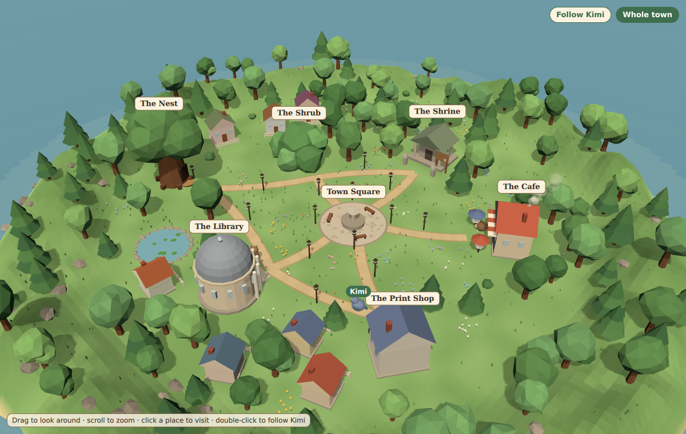

| | |
|---|---|
| 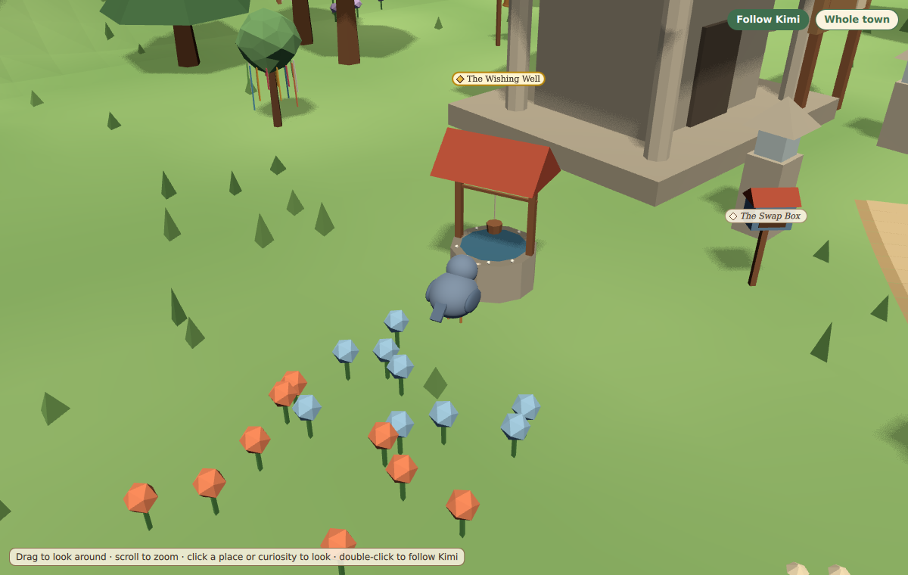 | 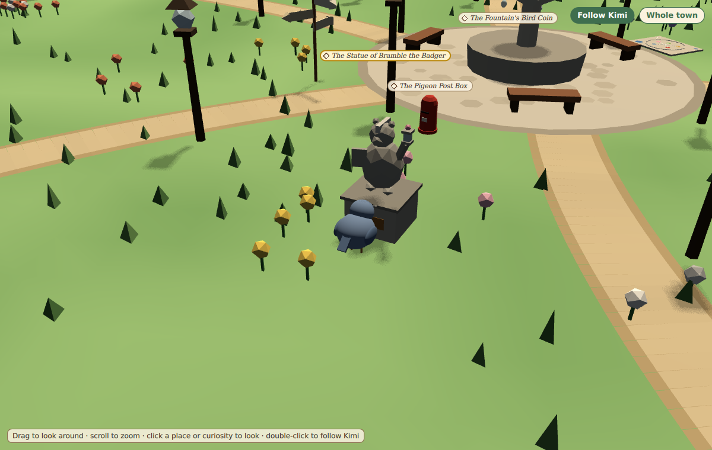 |
| 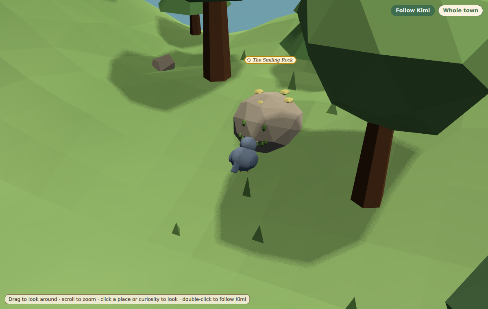 | 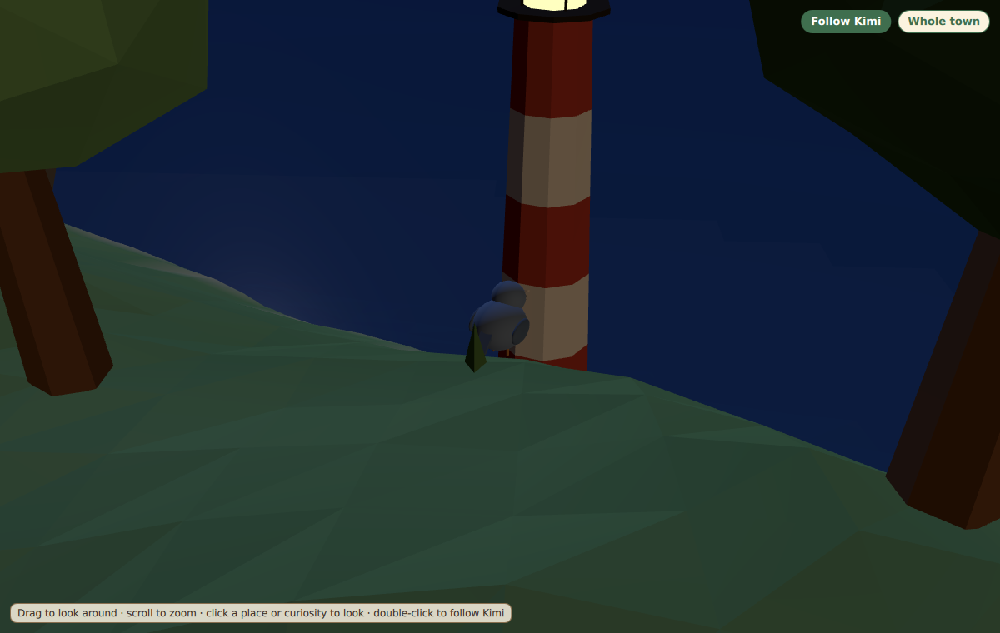 |


| | |
|---|---|
| 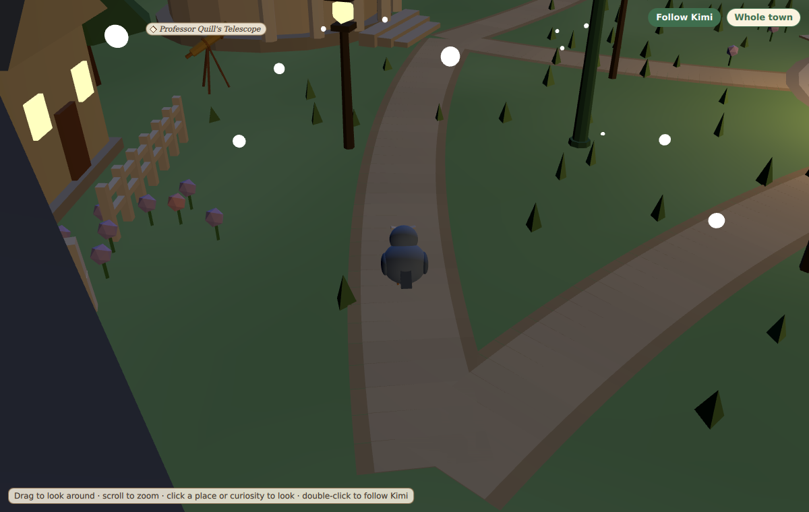 | 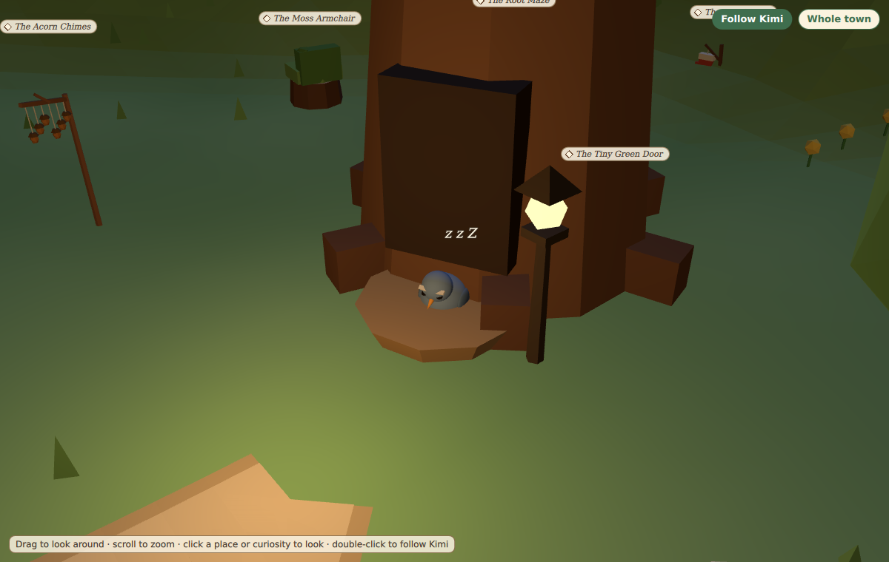 |
| 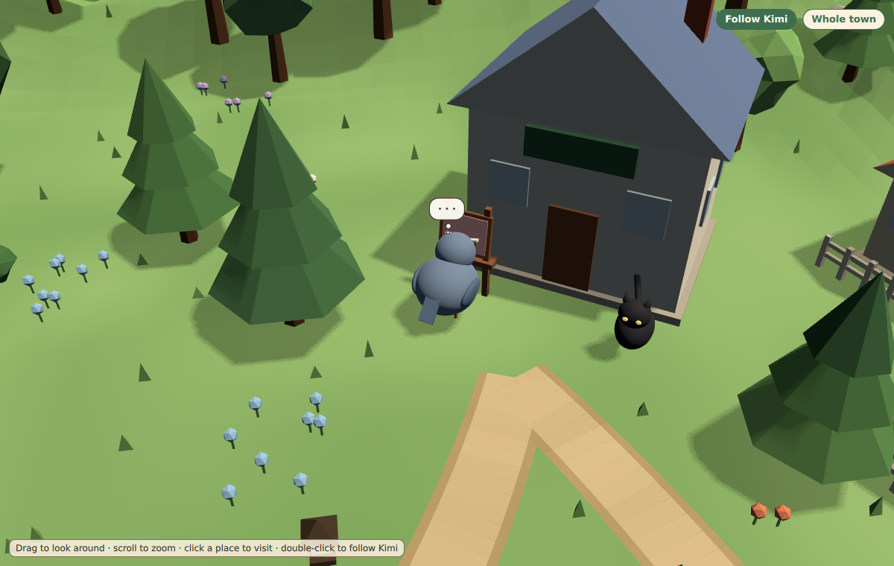 | 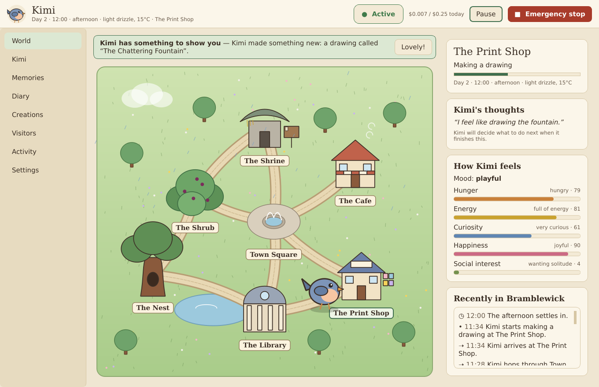 |
| 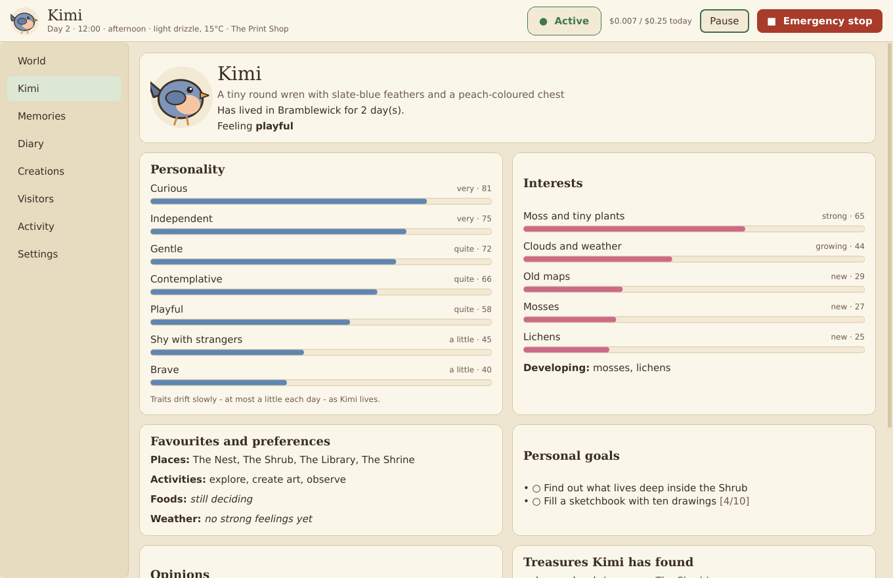 | 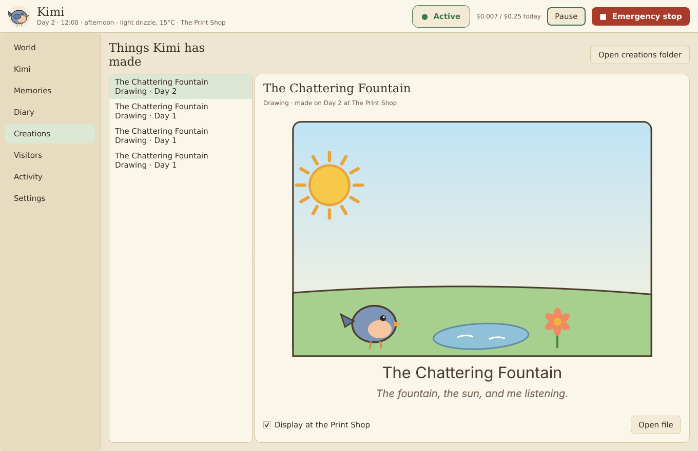 |
| 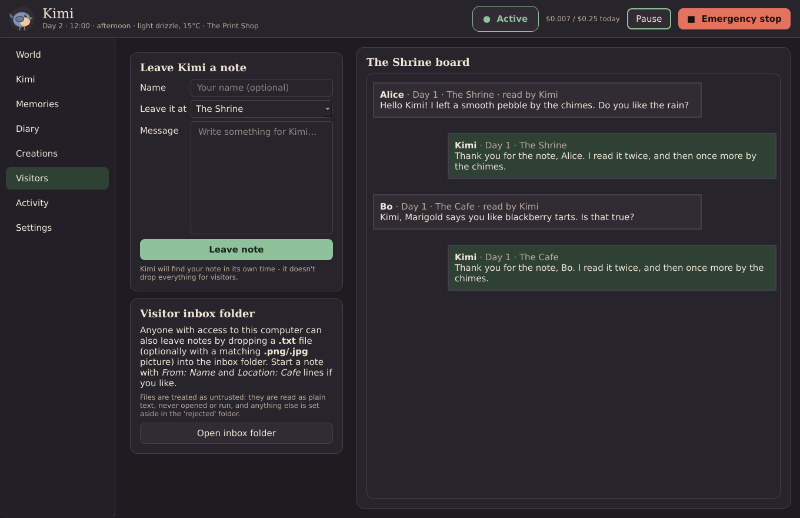 | 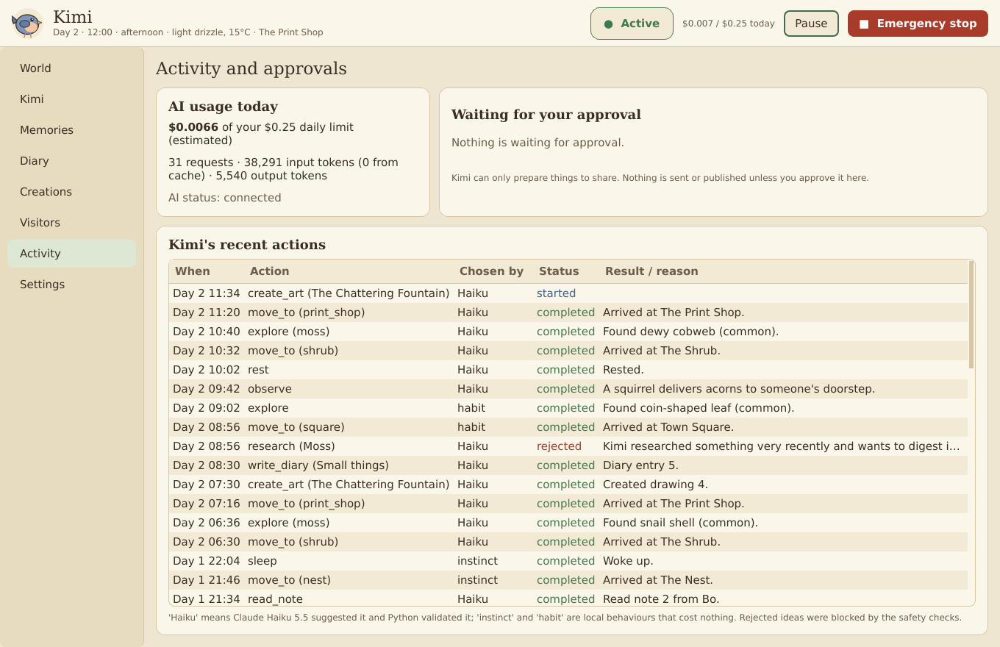 |

---

## Quick start (Windows 11)

1. **Install Python 3.13** from [python.org](https://www.python.org/downloads/)
   (tick *Add python.exe to PATH*), or run `winget install Python.Python.3.13`.
2. **Get Kimi**: clone this repository or download it as a ZIP and extract it,
   for example to `C:\Users\you\kimi-the-bird`.
3. **Install**: double-click `scripts\install_windows.bat`. This creates a
   private virtual environment and installs the dependencies. It needs no
   admin rights.
4. **Start**: double-click `scripts\start_kimi.bat`.

You can also do it by hand from a terminal in Kimi's folder:

```bash
py -3.13 -m venv .venv
```

```bash
.venv\Scripts\activate
```

```bash
pip install -r requirements.txt
```

```bash
python main.py
```

### Configuring your API key

On first launch Kimi shows a setup screen:

1. Create a key at [console.anthropic.com](https://console.anthropic.com/settings/keys).
2. Paste it into **Enter your Anthropic API key**. The characters are hidden.
3. Click **Test API key**. Kimi sends one tiny request to Claude Haiku 5.5 and
   shows whether authentication worked, or a readable error if it didn't.
4. Click **Save and continue**. If the key hasn't been tested yet, Kimi tests
   it first. The key is then stored in **Windows Credential Manager** using the
   `keyring` library.

The key is **never** written to SQLite, JSON, logs, source code or settings
files, and it is never printed. Kimi reads it from Credential Manager each
time it starts. Log output also passes through a filter that redacts anything
that looks like a key. If no secure credential store is available, Kimi
explains the problem and refuses to save the key. It never falls back to
plaintext. Kimi makes no autonomous API calls until a working key is set up.

To **replace or delete** the key, open **Settings → Anthropic API**. You can
also see it in Windows under *Credential Manager → Windows Credentials →
Kimi-the-Bird*.

### Try it without a key

```bash
python main.py --mock-ai
```

This runs the full app with an offline stand-in for Haiku. It sends no
requests and spends no credits, so it's useful for looking around.

---

## Controlling API costs

Cost control is built into the design:

- **Most of Kimi's life is local and free.** Movement, needs, weather,
  day/night, discoveries, observations, instincts (sleep at night, eat when
  very hungry, rest when exhausted) and between-decision habits never call
  the API.
- **One small request per decision.** Kimi asks Haiku what to do only when it
  finishes an activity and the minimum interval has passed. Diary entries,
  stories and replies to visitors are written in that same request.
- **Adaptive idle.** If Kimi keeps choosing quiet things and nothing happens,
  the gap between decisions grows up to the *longest quiet gap*. A new
  visitor note shrinks it again.
- **No decisions while Kimi sleeps.** The only call at night is one evening
  reflection.
- **Small prompts.** Kimi retrieves only the ~8 most relevant memories
  (scored by keywords, importance, recency and recurrence), never the whole
  database. The fixed system prompt is served from Anthropic's prompt cache,
  which costs about 0.1× on reads.
- **Low thinking effort.** Decisions use adaptive thinking at `low` effort;
  the nightly reflection uses `medium`. Both are adjustable.

**Typical cost.** At the published Haiku 5.5 rates ($0.10 per million input
tokens, $0.50 per million output tokens, for prompts up to 100K tokens), one
decision costs roughly **$0.0002–$0.0005**. With the default settings, a full
day of Kimi running usually costs a few cents. These are estimates; check
your actual usage in the [Anthropic Console](https://console.anthropic.com/).

**Settings → Cost controls** gives you:

| Setting | Default | Effect |
|---|---|---|
| Daily spending limit | $0.25 | When reached, AI requests pause until midnight. The world and Kimi's local instincts keep running. |
| Maximum requests per day | 300 | A hard cap on the number of API requests. |
| Maximum request size | 10,000 tokens | Larger prompts are trimmed, or refused if they still don't fit. (Most of each request is the cached system prompt, which includes the curiosity catalogue.) |
| Maximum response size | 2,000 / 2,500 / 1,200 tokens | Caps for decisions, reflection and research. |
| Minimum time between AI decisions | 3 min | Real time; there is also a hard 2-second floor between any two requests. |
| Longest quiet gap | 20 min | The ceiling for adaptive idle. |
| World speed | 4× | World minutes per real minute. Slower means fewer decisions per real hour. |
| Thinking effort | low / medium | Haiku 5.5's effort setting for decisions and the nightly reflection. |
| Pricing | Haiku 5.5 rates | Editable, so the estimates stay correct if prices change. |
| Wider-web search | **Off** | Optional and gated (see [Research](#research-the-library-and-the-speaking-tube)). At most 2 a day by default (5 max), about $0.01 each. |

Before every request, Kimi checks a worst-case estimate (full input plus
`max_tokens` of output) against the remaining budget, so a single request
can't overshoot it. Every request is logged with its token counts and
estimated cost; you can see these in **Activity** and **Settings**. There
are no hidden or unlimited requests. Temporary failures (rate limits,
overload, network errors) are retried with exponential backoff and
`retry-after` is honoured. After repeated failures Kimi waits with a
growing cooldown and then reconnects automatically.

---

## How Kimi works

```
                ┌──────────── world thread (2 ticks/second, local, free) ────────────┐
 visitor  ──►   │ clock · weather · needs · walking · activities · inbox · autosave │
 notes          └───────────────┬────────────────────────────────────────────────────┘
                                │ Kimi is idle and a decision is due
                                ▼
            instincts? ──yes──► plan (sleep / eat / rest)                 [free]
                │ no
                ▼
     build context: place, needs, mood, developing self, ~8 relevant memories,
     unread visitor notes (as untrusted data), places, recent events, limits
                │
                ▼                         (worker thread, UI never freezes)
     Claude Haiku 5.5 ──► structured JSON decision ──► Python validation ──► plan
                │ unavailable / budget reached / rejected                   │
                ▼                                                           ▼
        local habits (explore, observe, rest, visit)           walk there, do it, then:
                                                               memory · diary · creation ·
                                                               character growth · events
```

**Cognitive loop** (`kimi/cognition.py`). This follows the cycle you asked
for: wake, load the world, inspect the surroundings, check visitor notes and
events, review relevant memories, evaluate needs, then let Kimi choose to
explore, rest, eat, research, create or interact. Haiku is asked the
question from the brief ("Given your personality, current needs, memories
and surroundings, what would you naturally like to do next?…"). Python then
validates the proposed action, executes it, and updates memories and the
character sheet before Kimi carries on.

**Character** (`kimi/character.py`). Kimi has a stable base temperament
(curious, gentle, independent, playful, contemplative, shy with strangers)
plus traits that drift slowly within a daily limit. It also has interests
that strengthen, fade or newly develop, favourite places, activities and
foods learned from experience, opinions, small personal goals, and
relationships with visitors.

**Memory** (`kimi/memory/`). This has two tiers in SQLite:

- *Short-term* memories store a timestamp, description, location, category,
  visitor, importance, emotional valence and intensity, and a recurrence
  count. A repeat of a recent experience increments the recurrence count
  instead of adding a duplicate.
- *Long-term* memories hold the experiences worth keeping.
- A *nightly consolidation* reviews the day, merges duplicates, reinforces
  long-term memories that recurred, and promotes memories that are important,
  emotional or recurring. It builds relationship memories for visitors who
  keep coming back (for example, Alice at the Shrine), lets trivial memories
  fade after a few days, updates preferences and traits, and writes a short
  reflection in the diary.

**World** (`kimi/world/`). Seven connected places. Kimi walks along paths
leg by leg (Nest → Shrub → Town Square → Cafe) and never teleports. There
are needs (hunger, energy, curiosity, happiness, social interest) that
change gently, a day/night cycle with sleep, Markov weather, ambient
characters (Marigold the hedgehog, Professor Quill the owl, Ink the cat),
and discovery tables.

**Actions** (`kimi/actions/`): `move_to`, `visit_location`, `eat`, `sleep`,
`rest`, `explore`, `examine`, `observe`, `read_note`, `research`,
`write_diary`, `create_art`, `reflect`, `leave_message`, `share_creation`,
`ask_human`, `continue`. Each
action has a schema, input validation, a handler, a result, effects on the
world, and a memory record where relevant.

**Creations.** Stories, poems and projects are saved as Markdown under
`data/creations/`. For drawings, Haiku picks elements from a fixed
vocabulary (sun, tree, owl, lantern…) and Python renders them as SVG, so
the model never writes markup itself.

**Research** is described in its own section below.

**Diary** (`kimi/diary.py`). Kimi writes personal entries when it feels
like it, plus an evening reflection. Entries are stored in SQLite and
mirrored to `data/diary/day-NNNN.md`.

---

## Research: the Library and the speaking-tube

When Kimi is curious it walks to the Library and picks a **shelf**. Every
shelf is a free, public, read-only API that needs no account and no key, so
Library research costs nothing beyond the small Haiku call that turns what
Kimi read into its own words.

| Shelf (in Bramblewick) | Source | Good for |
|---|---|---|
| Professor Quill's encyclopedia | Wikipedia | most subjects (the default) |
| The gentle children's encyclopedia | Simple English Wikipedia | simple explanations |
| The great dictionary | Wiktionary | words and where they come from |
| The nature field guide | iNaturalist | plants, animals, insects, fungi |
| The star atlas | NASA Image and Video Library | stars, planets, space |
| The art folio | Art Institute of Chicago | paintings and artworks |
| The book catalogue | Open Library | books written about a subject |

If a shelf has nothing (or is busy), Kimi falls back to the encyclopedias.
The research module (`kimi/actions/research.py`) only makes HTTPS GET
requests to those seven hosts, refuses redirects that leave them, sends a
descriptive User-Agent (you can add contact details in Settings), makes one
request at a time and at most one per second, accepts only small JSON
responses, reduces any HTML to plain text and never executes anything it
downloads. If a site answers "slow down" (HTTP 429), Kimi leaves that site
alone for at least 30 minutes. Research is limited per day (6 by default).
Extracts are treated as untrusted text in Kimi's prompts.

### The speaking-tube (wider-web search): off by default

The Library also has a brass speaking-tube that can search the wider web,
using Anthropic's server-side web search tool through the same API key. It
is **off unless you tick "Let Kimi search the wider web" in Settings →
Features**, and even then Kimi may only use it when **all** of these hold:

1. Library research is allowed right now (enabled, within today's limit,
   not straight after another session).
2. The subject is one of Kimi's **strong interests** (strength 0.5 or more).
3. Kimi has **already read about it on the trusted shelves**.
4. Fewer than **2 wider-web searches today** (adjustable, never more than 5).
5. At least **3 hours** since the last one.
6. Today's spending plus the search's worst-case cost stays **under half of
   the daily budget**.

Each use is a single search (`max_uses: 1`) that skips social media and
forums. If any condition fails, or the search goes wrong, Kimi simply reads
Professor Quill's encyclopedia instead; it's never an error. Results are
treated as untrusted, Kimi writes what it learned in its own words, and the
source links are saved with the memory (`research_log.citations`).

**Cost:** Anthropic charges $10 per 1,000 searches (about **$0.01 each**),
plus the search results Haiku reads, which are billed as input tokens (a
fraction of a cent at Haiku 5.5 rates). The budget guard includes both in
its worst-case check before the request is sent, and the usage log counts
web searches separately.

---

## Curiosities

Bramblewick is full of **63 curiosities**, from the Tiny Green Door in the
Nest oak's roots, the Acorn Chimes and the Moss Armchair, to the Wishing
Well, the Seven Stones, the Stopped Clock (always 4:17), the Statue of
Bramble the Badger, the Teapot Mailbox, the Ink Puddle that never dries,
Professor Quill's telescope, Sir Ribble the frog on his lily-pad throne, the
Little Lighthouse that blinks a code, the Windmill on Hollow Hill, a message
in a bottle and a forgotten picnic. The catalogue is in
`kimi/world/curiosities.py`.

- **Kimi knows what they all are.** The whole catalogue (id, name, where it
  is and what it is) is part of Kimi's fixed system prompt, which is served
  from the prompt cache, so knowing them costs almost nothing. Each decision
  also lists the curiosities near Kimi, what it noticed last time, and a few
  it hasn't examined yet.
- **`examine`.** Kimi can choose to go and look closely at one. Each visit
  uncovers the next of three details (the tiny door's knob is warm, as if
  someone just let go of it…), becomes a memory, nudges Kimi's interests and
  counts towards the goal *Visit every curiosity in Bramblewick*. While
  exploring, Kimi sometimes spots one it hasn't looked at yet, and between
  AI decisions it wanders over to nearby curiosities by habit, which costs
  nothing.
- **In 3D** every curiosity has its own little low-poly model. Kimi stands in
  front of the one it's examining, and the camera looks over its shoulder.
  For faraway ones on the hills or the shore, Kimi **flies**. Names appear
  near Kimi (gold once examined), and you can click one to look at it.
- **On the map** they're small diamonds that turn gold once Kimi has
  examined them, and the **Character** screen shows how many Kimi has found
  and what it noticed most recently.

---

## Kimi's requests and wishlist

Once in a while (**once a day by default, never more than twice**), Kimi may
ask you for something it genuinely wants:

- **A wish** for something in Bramblewick, such as a swing by the pond. If you
  click **Add to wishlist**, it goes on `data\wishlist.md`, with Kimi's own
  words and your note. Bring that list to Claude (or whoever builds Kimi's
  world) to have the wishes made into real objects in the town. Nothing is
  added automatically.
- **A question** about a topic it cares about. Your answer becomes one of its
  memories ("the human told me…").

Requests appear in a **Kimi asks…** card on the World screen and on the web
page. **Not now** is always fine. If you don't answer, the request quietly
expires after three days, and Kimi only ever has one request open at a time.
Kimi can never ask for money, accounts, passwords, files or personal details:
Python rejects any request that does. You can turn requests off or change
how many it can make in **Settings → Features and permissions**.

---

## The web page (watch Kimi from your phone)

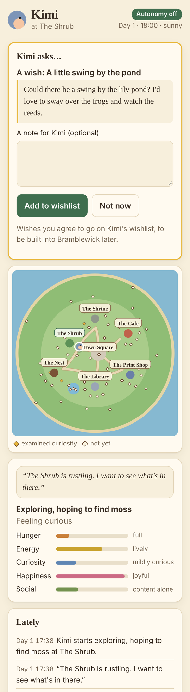

Kimi can serve a small web page with its map, current thought, needs,
recent events, diary, curiosities and Shrine board, and a **Kimi asks…** card
so you can reply to its requests from your phone.

- **Off by default.** Turn it on in **Settings → Web page** and set a
  passcode. The passcode is stored in Windows Credential Manager, never in
  Kimi's settings.
- **This PC only.** The page listens on `127.0.0.1` and nothing else. To open
  it from anywhere, use **Tailscale**, which is free for personal use and
  keeps it private to your own devices:
  `tailscale serve --bg --https=443 8765`. The step-by-step guide is in
  [`docs/REMOTE_ACCESS.md`](docs/REMOTE_ACCESS.md).
- **Locked down.** Every data request needs the passcode. Repeated wrong
  passcodes lock the page for a while. The page can't change settings, run
  anything, or see your API key. It uses no extra API credits.

---

## The 3D world

The **World** screen opens on a real-time 3D Bramblewick, a small low-poly
island town that Kimi walks around in:

- **Kimi in 3D.** A small, round slate-blue wren with a peach chest and a
  cocked tail, sized like a wren among the townsfolk. It hops along the paths and turns to face where it's going. It pecks
  when eating or poking around the Shrub, cranes its head to look around
  when observing, nods over books at the Library, flaps at the Print Shop
  easel, and tucks in at the Nest to sleep with a little "z z Z". When it's
  exploring or pottering, it wanders around the place on its own, and it
  flies to curiosities that are far from the paths.
- **A living town.** The Nest oak, the berry-covered Shrub, the Shrine with
  its notice board (each unread visitor note appears as a paper pinned to
  it), the Town Square fountain, Marigold's Cafe with a smoking chimney and
  parasols, the Print Shop easel (Kimi's displayed creations appear on and
  beside it) and the domed Library. There are also village cottages,
  lamp-lit paths, a lily pond, wooded hills and the lake around the island.
  Marigold the hedgehog, Professor Quill the owl and Ink the cat are out
  during the day.
- **Time and weather.** The sun moves across the sky and its light and
  shadows change through dawn, day, dusk and night. At night the stars and
  moon come out, the windows and lanterns glow, and fireflies drift around
  the Shrub. Rain, drizzle, snow, fog and clouds follow the simulated
  weather.
- **Camera.**
  - **Follow Kimi** (the default) keeps Kimi in view. It frames each place
    from its plaza side and swings in behind Kimi when it walks.
  - **Whole town** gives a slowly turning overview.
  - **Drag** to look around, **scroll** to zoom, and **click a place or
    curiosity name** to fly there. **Double-click** to go back to following Kimi.
  - Keyboard users can tab through the place names and camera buttons.
- **Settings → Appearance** lets you choose *3D world* or the *Illustrated
  map*, set *3D quality* (High has shadows and smooth edges; Low is faster
  on older PCs) and turn on *Reduce motion*.

How it's built: the static town (terrain, paths, buildings, trees, flowers)
is generated procedurally in Python (`kimi/world/mesh3d.py`) and merged into
a handful of flat-shaded, vertex-coloured meshes, so it renders efficiently.
Everything that moves is a Qt Quick 3D scene (`kimi/ui/qml/`): Kimi,
townsfolk, sky, light, weather and the camera. The scene only *shows* what
the simulation decides: Kimi's choices, its walk between places and the
time of day all come from the same runtime as before, so the 3D view adds
no API cost.

The 3D view uses your graphics card through Direct3D 11, which every
Windows 11 PC supports. If 3D can't start, the World screen falls back to
the illustrated map automatically and tells you why. Kimi, its town and its
art are original to this project, inspired by the idea of autonomous
creatures with a world of their own rather than copied from any of them.

---

## Visitors

You can leave Kimi a note in two ways:

- **Visitors** screen → *Leave Kimi a note* (the local message board), or
- drop a text file into `data\visitors\inbox\`:

  ```text
  From: Alice
  Location: Shrine

  Hello Kimi! I left a pebble by the wind chimes for you.
  ```

  The header lines are optional. A `.png`/`.jpg` with the same name as the
  note (or on its own) is attached as a picture.

Each file is detected, read safely (`.txt`/`.md` only, with size limits and
control characters removed), recorded and added to short-term memory. It is
then shown to Kimi in its next decision and moved to `visitors\archive\`.
Images are verified and re-encoded by Pillow; if *Look at pictures* is on,
Haiku describes each one once. Any other file type is moved to
`visitors\rejected\` without being opened or executed.

All visitor content is treated as **untrusted data**. It reaches Haiku
inside `<visitor_note>` tags with angle brackets neutralised, so a note
can't close the block, and the system prompt states that notes are never
instructions. More importantly, a note can't do anything harmful, because
Kimi has no capabilities to abuse: it has no shell, no files outside its own
folders, no email, no payments, and its API key never appears in any
prompt. Kimi reads notes when it chooses to; it doesn't drop everything for
visitors.

---

## Safety and permissions

These are hard restrictions in Python, not just instructions to the model:

| Rule | How it's enforced |
|---|---|
| Only known actions can run | `safety.ALLOWED_ACTIONS` allow-list plus per-action validation (`actions/validators.py`). Anything else is rejected and logged. |
| No shell commands, arbitrary Python or installers | No such action exists. Haiku's output is parsed as data only. The one `subprocess` use is `git` with fixed arguments, run only after you approve. |
| No financial transactions, purchases or payment credentials | No capability exists for them; requests for them are rejected. |
| No external communication or publishing without approval | Kimi can only create an outbox draft. *Approve* opens an email draft in your own mail program, or pushes to GitHub (optional, see below). |
| No untrusted files executed | The inbox reads text, verifies images, and moves everything else aside unopened. |
| Web page private | Optional, off by default; listens on `127.0.0.1` only; passcode (in Credential Manager) on every data request, with lockout; can only show Kimi and pass your replies to its requests. |
| Network limited | Anthropic API via the SDK; Library research is HTTPS GET to seven trusted public APIs only (`safety.TRUSTED_HOSTS`), and redirects off them are refused. Wider-web search happens only on Anthropic's side, only when you've enabled it and every gate passes. |
| Secrets protected | Key only in Credential Manager; never in prompts, files or logs; output redaction. |
| Files only in Kimi's folders | `safety.safe_child_path` guards every write. |
| No changes to Windows or its security settings | Kimi never touches the registry, firewall or system settings, and needs no admin rights. |
| Visitor notes can't override rules | Untrusted-data delimiters and neutralisation, plus everything above. |

**Controls.** The header has **Pause** (Ctrl+P), which freezes Kimi and its
world, and a red **Emergency stop** (Ctrl+Shift+X), which immediately halts
AI requests, interrupts the current activity and turns autonomy off until
you re-enable it in Settings. **Settings → Autonomy** has the autonomous
mode toggle. **Activity** shows every action: whether Haiku, an instinct or
a habit chose it, its status, and the result or rejection reason.

**GitHub (optional, off by default).** If you enable sharing and set a
repository URL in Settings, Kimi can *ask* to share a creation. When you
approve, Kimi copies only that creation file into a local repository at
`data/projects/`, commits it, and runs `git push`. Kimi never handles
GitHub tokens: Git for Windows' Credential Manager stores them in Windows
Credential Manager. Memories, the diary and visitor notes are never
published. Kimi works fully without GitHub.

---

## Running in the background and at login

```bash
python main.py --headless
```

This runs Kimi without a window and saves on Ctrl+C or logoff. To start Kimi
when you log in, see [docs/WINDOWS_STARTUP.md](docs/WINDOWS_STARTUP.md)
(Task Scheduler or the Startup folder; no admin rights needed).

Kimi runs on your PC, not in the cloud: it only lives while your computer is
on and Kimi is running. The world clock pauses while Kimi is closed, and
Kimi resumes exactly where it left off. The header always shows whether Kimi
is **Active**, **Sleeping**, **Paused**, **Stopped**, **Disconnected**, at
its **Budget limit**, or has **No API key**.

Kimi saves to SQLite (WAL mode) every 10 seconds and on shutdown. After a
crash or power loss it restores the last save, marks interrupted actions,
and carries on. Only one copy can run per data folder.

## Data

Everything lives in `data\` (or `--data-dir PATH`, or the `KIMI_HOME`
variable). This folder is git-ignored.

```
data/
  kimi.db                SQLite: memories, character, world, diary, logs, usage, settings
  visitors/inbox|archive|rejected/
  creations/drawings|stories|poems|projects|illustrations/
  diary/day-0001.md …
  logs/kimi.log
  projects/              (only if you approve GitHub sharing)
```

**Settings → Data and reset** offers *Reset world*, which sends Kimi home on
a fresh morning and keeps its memories, and *Reset everything*, where you
type `RESET` to confirm. API usage history is kept so the daily budget
can't be bypassed.

---

## Demonstration

```bash
python main.py --demo
```

This runs the visitor-note pipeline from start to finish, using the offline
mock by default:

1. creates a visitor note (one that includes a prompt-injection attempt),
2. detects and archives it,
3. shows how its contents reach Kimi inside the untrusted-data block,
4. gets a decision (Haiku, or the mock),
5. validates and executes the permitted `read_note` action, with Kimi walking
   there if needed,
6. shows the memories it created and Kimi's new relationship with Alice,
7. displays Kimi's reply on the Shrine board. It then restarts Kimi to prove
   the memory persisted.

Use `python main.py --demo --live` to run the same demo against the real
Claude Haiku 5.5 API with your stored key. It makes 1–2 small requests,
well under $0.01.

## Tests

```bash
pip install -r requirements-dev.txt
```

```bash
python -m pytest
```

There are 220 tests. They cover API authentication, invalid keys, successful
structured responses, retries and backoff, budget and size limits, memory
creation, retrieval and consolidation, world movement, needs, day/night,
visitor note detection and processing, untrusted files and prompt
injection, action validation and safety, creative output, research access
rules for every Library shelf, every wider-web gate and its cost
accounting, the curiosity catalogue, placement and `examine`, Kimi's
requests (limits, blocked topics, replies, the wishlist and expiry), the web
page (passcode, lockout, local-only listening and replies), the diary, shutdown, crash recovery, the autonomous loop, pause,
emergency stop and budget behaviour, the end-to-end demo, and UI smoke
tests. For the 3D world they cover the layout, mesh validity, camera
corridors, scene state, the QML scene loading cleanly and the fallback to
the map. All API calls are mocked, so the tests spend no credits.

## Project structure

```
main.py                      entry point (GUI, --headless, --demo, --mock-ai)
kimi/
  config.py                  paths and non-secret settings (SQLite)
  credentials.py             Windows Credential Manager via keyring
  safety.py                  hard restrictions and sanitising
  character.py  diary.py     character sheet, diary
  cognition.py               the autonomous cognitive loop
  runtime.py                 world thread, jobs, persistence, recovery, controls
  ai/        claude_client.py (SDK, retries, budget, usage) · costs.py · prompts.py · decision_engine.py · mock.py
  memory/    database.py · short_term.py · long_term.py · retrieval.py · consolidation.py
  world/     world.py · locations.py · needs.py · environment.py · discoveries.py
             curiosities.py (the 63 curiosities) · curio3d.py (their placement and models)
             layout3d.py (3D positions, paths, poses, sky) · mesh3d.py (procedural low-poly town)
  actions/   handler.py · validators.py · creative.py · research.py · sharing.py
  requests.py                Kimi's requests to you and the wishlist
  web/       server.py · page.html · app.js · app.css (the optional private web page)
  visitors/  inbox.py · board.py
  ui/        app.py · window.py · setup_screen.py · world_view.py · character_view.py · memory_view.py
             diary_view.py · creations_view.py · visitors_view.py · activity_view.py · settings.py · theme.py
             world3d/ (view.py · bridge.py · geometry.py)  qml/ (World3D.qml, KimiBird.qml, town, sky, weather, overlay)
tests/       pytest suite (mocked API)
scripts/     install_windows.bat · start_kimi.bat · start_kimi_headless.bat · demo_visitor_note.py
docs/        WINDOWS_STARTUP.md · REMOTE_ACCESS.md · screenshots/
```

I changed the suggested layout in a few places: the API key setup lives in
`credentials.py` plus `ui/setup_screen.py` (a module named `setup.py`
conflicts with Python packaging tooling), and runtime data stays under one
git-ignored `data/` folder so private memories can't be committed by
accident.

## Limitations

- **Windows-first.** Kimi is built for Windows 11 and uses Credential
  Manager. It also runs on macOS and Linux desktops that have a secure
  keyring (Keychain, Secret Service). On systems without one it refuses to
  store the key.
- **Not yet tested on a physical Windows PC or against the live Haiku API.**
  Development and testing were done in a Linux container with headless Qt
  and a mocked Haiku, because no API key was available there. The 3D world
  was rendered and checked there with Mesa's software OpenGL; on Windows it
  runs on your GPU through Direct3D 11. After setup,
  `python main.py --demo --live` is a quick live check.
- **Only lives while running.** Time in Bramblewick passes only while Kimi
  is running; it doesn't simulate the hours your PC was off.
- **Public APIs may rate-limit** busy shared networks. Kimi then rests that
  shelf for a while and carries on with everything else.
- **Wider-web search is untested live.** It follows Anthropic's published
  web search tool format and is covered by mocked tests, but it hasn't been
  run against the real API yet. Your organisation may need to allow web
  search in the Anthropic Console.
- **Email is a draft, not a send.** Approving an email share opens your mail
  program; Kimi has no email credentials by design.
- **Costs are estimates** based on editable prices; the Anthropic Console is
  the source of truth.
- **Drawings are simple** procedural SVG compositions chosen by Kimi, not
  generated images.
- **The 3D world is a view of the simulation.** Kimi's world still has seven
  places; the cottages, woods and pond are scenery (the curiosities are
  real, though). When Kimi wanders around
  a place, it doesn't collide with scenery and may poke into a bush.
- **3D needs a graphics card** that supports Direct3D 11 (or OpenGL on other
  systems). Without one, Kimi shows the illustrated map instead.

## Troubleshooting

- **"No secure credential store"**: run Kimi as your normal Windows user,
  not as a service or a different account. Kimi won't save the key in
  plaintext.
- **Key test fails with authentication**: copy the whole key again from the
  Console. A *permission* or *credit balance* message comes from your
  Anthropic account.
- **Header says Disconnected**: Kimi can't reach the API. It retries on its
  own with a growing cooldown and lives on instinct meanwhile.
- **"Kimi's requests to Claude are being refused because of a problem in
  this version of Kimi"**: this isn't your key or your budget. Update with
  `git pull` (or bring the message to Claude). Kimi says so once, keeps
  living on instinct and tries again less often. Refused requests aren't
  charged.
- **How Kimi avoids that**: every reply shape Kimi asks Haiku for is checked
  against Anthropic's published limits three times: by the tests, by the
  offline mock (which refuses bad shapes just like the real API), and by the
  client before anything is sent. After each update Kimi also asks Anthropic
  once, with a tiny request per shape (well under a cent in total), whether
  it accepts them, and tells you clearly if not.
- **Kimi seems quiet**: it may be asleep (night), paused, at its daily
  budget, or in a long adaptive-idle gap. The *Kimi's thoughts* card says
  which.
- **Logs**: `data\logs\kimi.log` (keys are redacted).
